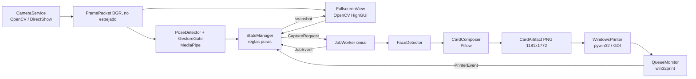

# Kippu — El Bienvenidor: Documento Maestro de Arquitectura y Ejecución

| Campo | Valor |
| --- | --- |
| Estado | Propuesta técnica base para implementación |
| Plataforma objetivo | Windows 11 nativo, PC Intel i3 11.ª generación, 8 GB RAM |
| Runtime | Python 3.10 o superior, entorno virtual (`venv`) |
| Restricciones no negociables | Sin Docker, sin WSL2, sin servicios remotos requeridos |
| Salida física | Carnet vertical 10 x 15 cm, 1181 x 1772 px, 300 DPI |
| Interacción principal | Gesto de saludo sostenido, cuenta regresiva, captura e impresión silenciosa |

## 1. Propósito y límites

El Bienvenidor es un kiosco local de captura e impresión. Debe mostrar una vista previa espejada a pantalla completa, reconocer una mano por encima de un hombro durante 1,5 segundos continuos, capturar una fotografía, componer un carnet y entregarlo a la cola de la impresora predeterminada sin diálogos del sistema.

La aplicación es un único proceso Python nativo de Windows. Tiene un hilo principal para cámara, detección de pose, máquina de estados y renderizado; y un único hilo de trabajo para composición e impresión. No habrá procesos hijos, contenedores, navegador embebido, servidor web ni historial de vídeo. Esta decisión mantiene bajo control memoria, complejidad de despliegue y recuperación del hardware.

La impresión “exitosa” significa que el spooler de Windows aceptó el trabajo y devolvió un identificador. No significa que el papel haya salido físicamente: los drivers pueden aceptar un trabajo aun sin papel. El sistema monitoriza la cola y muestra una incidencia si el driver comunica un error.

### Decisiones de producto que se fijan desde el inicio

- La vista previa se espeja sólo para el usuario. La captura de origen se conserva sin espejar por defecto, como hacen las cámaras de autoservicio. `capture_mirrored` será una opción explícita y por defecto será `false`.
- Sólo se procesa una persona. Si no hay rostro o se detectan rostros competidores, el trabajo falla de manera explicable; no se elige una cara arbitrariamente.
- Una vez iniciada la cuenta regresiva, el gesto no necesita mantenerse. `Esc` cancela la cuenta y vuelve a la vista previa.
- El modo de desarrollo es `dry_run`: compone la tarjeta y registra una impresión simulada, sin tocar ninguna impresora. Sólo el modo de operación habilita impresión real.
- El identificador de cada operación es un UUID. Va en el nombre del documento del spooler, en el directorio temporal y en todos los eventos de log.

## 2. Arquitectura de alto nivel

### 2.1 Componentes y responsabilidades



| Capa | Puede conocer | No puede conocer |
| --- | --- | --- |
| `camera` | OpenCV y configuración del dispositivo | UI, MediaPipe, impresora |
| `vision` | Píxeles y modelos MediaPipe | Estado global, GDI, archivos de tarjeta |
| `core` | Modelos de dominio, reloj y eventos | OpenCV, Pillow, `win32print` |
| `ui` | `AppSnapshot`, frame para mostrar y comandos locales | Decisiones de gesto o impresión |
| `composition` | Imagen capturada, rostro validado, plantilla y texto | Cámara, UI, spooler |
| `printer` | `CardArtifact`, configuración de impresora y Win32 | Detección de cara, interfaz |
| `services` | Orquestación de una tarea ya autorizada | Reglas de transición de estados |

El `AppController` ensambla las dependencias y es el único sitio que conecta estas capas. Los módulos no importan el controlador ni se llaman circularmente. La máquina de estados es determinista y testeable con un reloj falso; el controlador sólo traduce entradas de hardware y del worker en eventos.

### 2.2 Concurrencia y presupuesto de recursos

- El hilo principal posee `cv2.VideoCapture`, `PoseDetector`, `GestureGate`, `StateManager` y `FullscreenView`. Lee un frame por iteración y no guarda un buffer de vídeo.
- `JobWorker` tiene una cola con capacidad **uno**. Recibe una copia inmutable del frame elegido, detecta/corta el rostro, compone y llama al backend de impresión. Envía eventos de progreso al hilo principal mediante una cola segura.
- Nunca se comparten instancias de MediaPipe entre hilos. El detector de rostro es propiedad del worker; el detector de pose es propiedad del hilo principal.
- Se limita inicialmente la cámara a 1280x720 y 30 FPS. Se mide el rendimiento antes de subir resolución. Un frame BGR de ese tamaño ocupa aproximadamente 2,8 MB; una tarjeta RGB ocupa aproximadamente 6,3 MB. Debe haber como máximo un frame de cámara vigente, una captura en trabajo y una tarjeta compuesta.
- `QueueMonitor` no hace polling desde la UI. El worker consulta la cola con una cadencia configurable (por defecto 1 s) durante la ventana de supervisión y luego informa al controlador.

### 2.3 Máquina de estados

```mermaid
stateDiagram-v2
    [*] --> STARTUP
    STARTUP --> IDLE: cámara abierta y printer probe apto
    STARTUP --> CAMERA_ERROR: cámara no disponible
    STARTUP --> PRINTER_ERROR: impresora no apta

    IDLE --> GREETING_HELD: saludo válido inicia
    GREETING_HELD --> IDLE: saludo inválido o perdido
    GREETING_HELD --> COUNTDOWN: saludo continuo >= 1.5 s
    COUNTDOWN --> IDLE: Esc / cancelar
    COUNTDOWN --> PROCESSING: termina 3..2..1; snapshot atómico

    PROCESSING --> PRINTING: tarjeta válida aceptada por spooler
    PROCESSING --> PROCESSING_ERROR: sin rostro / tarjeta / fallo antes de StartDoc
    PRINTING --> IDLE: mensaje mínimo mostrado y trabajo sin error conocido
    PRINTING --> PRINTER_ERROR: spooler o cola informa error

    IDLE --> CAMERA_ERROR: lecturas consecutivas fallidas
    GREETING_HELD --> CAMERA_ERROR: lecturas consecutivas fallidas
    COUNTDOWN --> CAMERA_ERROR: cámara desconectada antes de snapshot
    CAMERA_ERROR --> STARTUP: reintento de apertura
    PRINTER_ERROR --> STARTUP: reintento o acción operador
    PROCESSING_ERROR --> IDLE: timeout de mensaje o reconocimiento operador
```



`STARTUP` es una comprobación repetible, no sólo el arranque del proceso. La UI se renderiza en todos los estados: vista previa en `IDLE` y `GREETING_HELD`; congelado de la última captura en `PROCESSING` y `PRINTING`; y una pantalla de incidencia con instrucciones breves en los estados de error.

La transición `GREETING_HELD → COUNTDOWN` se calcula con `time.monotonic()`, no con FPS ni `datetime.now()`. Cada observación inválida reinicia el temporizador; así, una pose intermitente no acumula tiempo.

## 3. Contratos de dominio y flujo de datos

### 3.1 Tipos canónicos

Los tipos siguientes se declaran como `@dataclass(frozen=True)` salvo los enumerados. Son contratos, no una invitación a mezclar diccionarios anónimos entre módulos.

```python
FrameId = NewType("FrameId", int)
JobId = NewType("JobId", UUID)
Point = tuple[float, float]

class AppState(str, Enum):
    STARTUP = "startup"
    IDLE = "idle"
    GREETING_HELD = "greeting_held"
    COUNTDOWN = "countdown"
    PROCESSING = "processing"
    PRINTING = "printing"
    CAMERA_ERROR = "camera_error"
    PRINTER_ERROR = "printer_error"
    PROCESSING_ERROR = "processing_error"

class JobStage(str, Enum):
    PROCESSING = "processing"
    COMPOSED = "composed"
    SPOOLING = "spooling"
    MONITORING = "monitoring"
    SUCCEEDED = "succeeded"
    FAILED = "failed"

class PrinterDisposition(str, Enum):
    ACCEPTED = "accepted"
    PRE_START_FAILURE = "pre_start_failure"
    UNKNOWN_AFTER_SUBMIT = "unknown_after_submit"
    QUEUE_ERROR = "queue_error"

@dataclass(frozen=True)
class FramePacket:
    frame_id: FrameId
    captured_monotonic_s: float
    image_bgr: NDArray[np.uint8]       # H x W x 3, original de cámara, no espejo
    source_size: tuple[int, int]       # (width, height)

@dataclass(frozen=True)
class GestureObservation:
    salute_detected: bool
    wrist: Point | None
    shoulder: Point | None
    confidence: float
    reason: str

@dataclass(frozen=True)
class CaptureRequest:
    job_id: JobId
    frame: FramePacket
    requested_monotonic_s: float
    metadata: CardData

@dataclass(frozen=True)
class FaceCrop:
    image_rgb: Image.Image
    source_box_px: tuple[int, int, int, int]
    confidence: float

@dataclass(frozen=True)
class CardData:
    headline: str
    guest_name: str | None
    issued_at: datetime
    serial: str

@dataclass(frozen=True)
class CardArtifact:
    job_id: JobId
    png_path: Path
    pixel_size: tuple[int, int]        # siempre (1181, 1772)
    dpi: tuple[int, int]               # siempre (300, 300)
    sha256: str

@dataclass(frozen=True)
class PrintReceipt:
    job_id: JobId
    printer_name: str
    spooler_job_id: int | None
    submitted_at: datetime
    disposition: PrinterDisposition
    detail: str
```

`image_bgr` se copia en el borde del hilo antes de crear `CaptureRequest`; ningún frame que siga leyendo la cámara puede modificar esa memoria. El espejo es una operación de renderizado de UI (`cv2.flip`) y nunca altera `FramePacket`, salvo que una configuración explícita solicite `capture_mirrored`.

### 3.2 Contrato cámara → impresión

1. `CameraService.read()` emite un `FramePacket` BGR válido de una única cámara, con timestamp monotónico y dimensiones conocidas.
2. Cuando la máquina llega al cero de la cuenta, el controlador copia el último `FramePacket` válido y crea un `CaptureRequest` con UUID y `CardData` inmutables.
3. `JobWorker` transforma sólo esa captura en `FaceCrop` y luego en `CardArtifact`. Si no puede producir una tarjeta verificable de 1181x1772 a 300 DPI, no llama al módulo de impresora.
4. `WindowsPrinter.submit()` recibe sólo un `CardArtifact` ya validado. No recibe arrays de OpenCV, rostro, texto ni estado de UI. Devuelve `PrintReceipt` o un error tipado.
5. Un recibo `ACCEPTED` genera el evento `print_submitted`. Cualquier resultado ambiguo después de `StartDoc` se clasifica `UNKNOWN_AFTER_SUBMIT` y **nunca se reintenta automáticamente**, para evitar duplicados.

Los archivos se escriben en `data/jobs/<job_id>/card.png` con escritura atómica (archivo temporal y `replace`). Se preservan hasta que termina la ventana de monitorización y la política de retención los elimine. No se guardan frames de vista previa ni landmarks. Las fotografías son datos personales: `data/` queda ignorado por Git y protegido por ACL de la cuenta de servicio de Windows.

## 4. Estructura exacta del repositorio

```text
kippu/
├── README.md
├── pyproject.toml
├── requirements.txt
├── .gitignore
├── config/
│   ├── config.example.toml
│   └── config.toml                 # local; ignorado por Git
├── assets/
│   ├── templates/
│   │   └── README.md                 # reemplazar por carnet_base.png aprobado antes de imprimir en real
│   └── fonts/
│       └── LICENSES.md
├── docs/
│   └── EL_BIENVENIDOR_MASTER.md
├── scripts/
│   ├── bootstrap_windows.ps1
│   ├── run.ps1
│   └── diagnostic_windows.ps1
├── src/
│   └── el_bienvenidor/
│       ├── __init__.py
│       ├── __main__.py
│       ├── app.py
│       ├── config.py
│       ├── domain/
│       │   ├── __init__.py
│       │   ├── models.py
│       │   └── errors.py
│       ├── core/
│       │   ├── __init__.py
│       │   ├── events.py
│       │   ├── state_manager.py
│       │   └── clock.py
│       ├── camera/
│       │   ├── __init__.py
│       │   └── camera_service.py
│       ├── vision/
│       │   ├── __init__.py
│       │   ├── pose_detector.py
│       │   ├── gesture_gate.py
│       │   └── face_detector.py
│       ├── composition/
│       │   ├── __init__.py
│       │   ├── layout.py
│       │   └── card_composer.py
│       ├── printer/
│       │   ├── __init__.py
│       │   ├── win_printer.py
│       │   └── queue_monitor.py
│       ├── services/
│       │   ├── __init__.py
│       │   ├── job_worker.py
│       │   └── retention.py
│       ├── ui/
│       │   ├── __init__.py
│       │   ├── fullscreen_view.py
│       │   └── overlay.py
│       └── infra/
│           ├── __init__.py
│           ├── logging.py
│           └── storage.py
└── tests/
    ├── conftest.py
    ├── unit/
    │   ├── test_state_manager.py
    │   ├── test_gesture_gate.py
    │   ├── test_layout.py
    │   └── test_card_composer.py
    ├── integration/
    │   ├── test_camera_fake.py
    │   ├── test_job_worker_dry_run.py
    │   └── test_print_fake.py
    └── manual/
        ├── camera_disconnect_checklist.md
        └── printer_checklist.md
```

| Módulo | Responsabilidad única |
| --- | --- |
| `app.py` | Componer dependencias, ejecutar el ciclo principal y apagar ordenadamente. |
| `config.py` | Cargar TOML, validar rangos y exponer configuración inmutable. |
| `domain/models.py` | Única definición de DTOs, enumeraciones y tipos compartidos. |
| `domain/errors.py` | Excepciones tipadas con código, mensaje operador y causal técnica. |
| `core/events.py` | Eventos de entrada y salida; sin lógica de hardware. |
| `core/state_manager.py` | Transiciones válidas y creación de `AppSnapshot`. |
| `core/clock.py` | Reloj monotónico intercambiable por fakes de test. |
| `camera/camera_service.py` | Abrir, configurar foco, leer y liberar una webcam. |
| `vision/pose_detector.py` | Traducir landmarks MediaPipe a observación de saludo. |
| `vision/gesture_gate.py` | Aplicar umbral de confianza y duración continua de 1,5 s. |
| `vision/face_detector.py` | Hallar, validar y recortar un rostro dominante. |
| `composition/layout.py` | Constantes geométricas y validación de zonas de la tarjeta. |
| `composition/card_composer.py` | Componer PNG final con Pillow, sin impresión. |
| `printer/win_printer.py` | Enviar un artefacto al spooler mediante GDI/pywin32 sin diálogo. |
| `printer/queue_monitor.py` | Consultar estado de impresora y trabajo por Win32. |
| `services/job_worker.py` | Ejecutar una única captura autorizada y publicar progreso. |
| `services/retention.py` | Eliminar artefactos vencidos sólo según política explícita. |
| `ui/fullscreen_view.py` | Ventana fullscreen, eventos de teclado y render de estado. |
| `ui/overlay.py` | Dibujar cuenta, mensajes y ayudas sobre imágenes, sin reglas. |
| `infra/logging.py` | Logging JSON/rotativo y correlación por `job_id`; nunca loguea píxeles. |
| `infra/storage.py` | Rutas de trabajo y escritura atómica de artefactos. |

## 5. Especificación de interfaces

Las siguientes firmas son el API interno obligatorio. Se permiten helpers privados, pero no se cambian contratos ni se introduce acceso a hardware fuera de sus adaptadores.

```python
# config.py
def load_settings(path: Path) -> AppSettings: ...
def validate_settings(settings: AppSettings) -> None: ...

# camera/camera_service.py
class CameraService(Protocol):
    def open(self) -> CameraProbe: ...
    def read(self) -> FramePacket | None: ...
    def is_open(self) -> bool: ...
    def release(self) -> None: ...

def configure_focus(capture: cv2.VideoCapture, settings: CameraSettings) -> FocusResult: ...

# vision/pose_detector.py and gesture_gate.py
class PoseDetector(Protocol):
    def observe(self, frame: FramePacket) -> GestureObservation: ...
    def close(self) -> None: ...

def is_salute(landmarks: PoseLandmarks, settings: GestureSettings) -> GestureObservation: ...
def update_gesture_gate(previous: GestureGateState, observation: GestureObservation, now_s: float, hold_s: float) -> GestureGateState: ...

# core/state_manager.py
class StateManager:
    def dispatch(self, event: AppEvent, at_monotonic_s: float) -> Transition: ...
    def snapshot(self, now_monotonic_s: float) -> AppSnapshot: ...

# vision/face_detector.py
class FaceDetector(Protocol):
    def crop_primary_face(self, frame: FramePacket, policy: FaceCropPolicy) -> FaceCrop: ...
    def close(self) -> None: ...

# composition/card_composer.py
def compose_card(face: FaceCrop, data: CardData, layout: CardLayout, output_path: Path) -> CardArtifact: ...
def validate_card_artifact(artifact: CardArtifact) -> None: ...

# printer/win_printer.py
class PrintBackend(Protocol):
    def probe(self) -> PrinterProbe: ...
    def submit(self, artifact: CardArtifact) -> PrintReceipt: ...

# printer/queue_monitor.py
def inspect_printer(printer_name: str) -> PrinterStatus: ...
def inspect_job(printer_name: str, spooler_job_id: int) -> JobStatus: ...
def monitor_submission(receipt: PrintReceipt, policy: MonitorPolicy) -> PrintReceipt: ...

# services/job_worker.py
class JobWorker:
    def start(self) -> None: ...
    def submit(self, request: CaptureRequest) -> None: ...  # falla si ya existe trabajo
    def poll_events(self) -> list[JobEvent]: ...
    def stop(self, timeout_s: float) -> None: ...

# ui/fullscreen_view.py and ui/overlay.py
class FullscreenView(Protocol):
    def open(self) -> None: ...
    def render(self, snapshot: AppSnapshot, preview: FramePacket | None) -> None: ...
    def poll_commands(self) -> list[UserCommand]: ...
    def close(self) -> None: ...

def draw_overlay(image_bgr: NDArray[np.uint8], snapshot: AppSnapshot) -> NDArray[np.uint8]: ...

# infra/storage.py, retention.py and logging.py
def job_directory(job_id: JobId, settings: StorageSettings) -> Path: ...
def atomic_save_png(image: Image.Image, path: Path, dpi: tuple[int, int]) -> Path: ...
def purge_expired_jobs(now: datetime, policy: RetentionPolicy) -> RetentionReport: ...
def configure_logging(settings: LoggingSettings) -> None: ...

# app.py
def build_application(settings: AppSettings) -> Application: ...
def run_application(application: Application) -> int: ...
```

`CameraProbe` incluye índice de dispositivo, backend efectivo, resolución real, FPS reportado y resultado del foco. `PrinterProbe` contiene impresora predeterminada resuelta, estado Win32, resolución/capacidad GDI y una advertencia si la relación de área imprimible no es compatible con 10x15 vertical.

### 5.1 Reglas técnicas de visión

`PoseDetector` ejecuta MediaPipe Pose en el frame sin espejo. Un saludo es válido si, para el lado izquierdo o derecho, la muñeca tiene visibilidad y presencia mayores al umbral configurado y su coordenada vertical normalizada cumple:

`wrist.y < shoulder.y - vertical_margin`

Valores iniciales de configuración: `landmark_confidence = 0.65`, `vertical_margin = 0.05`, `salute_hold_seconds = 1.5`. Se comparan muñeca y hombro del mismo lado. La observación se considera inválida si MediaPipe no proporciona ambos landmarks confiables. El margen y los umbrales deben quedar en TOML para la calibración en sitio.

`FaceDetector` usa MediaPipe Face Detection sobre el snapshot. Requiere una cara con confianza mínima `0.80`; rechaza múltiples caras si la segunda tiene un área de al menos 65 % de la mayor. El crop mantiene relación y encuadre definidos por `FaceCropPolicy`, aplica padding, limita los bordes a la imagen y nunca reescala una región vacía. El rostro debe pasar validación de tamaño mínimo antes de la composición.

### 5.2 Composición

`CardLayout` tiene constantes expresadas en píxeles sobre un lienzo fijo de 1181 x 1772. `layout.py` centraliza: rectángulo de foto, zonas de texto, colores, tipografías, alineación, límites de caracteres y espaciado. `card_composer.py` no contiene coordenadas mágicas.

El compositor abre `assets/templates/carnet_base.png`, verifica sus dimensiones, coloca `FaceCrop.image_rgb` en la zona de foto con una operación de cubrir y recortar, dibuja `CardData` y guarda PNG RGB con DPI `(300, 300)`. Durante desarrollo puede generar una plantilla claramente marcada como tal, pero el modo de impresión real debe rechazar el arranque si no existe una plantilla aprobada. Antes de devolverlo debe reabrir el archivo y comprobar dimensiones, modo RGB/RGBA permitido, DPI y hash SHA-256. La fuente elegida debe distribuirse con licencia documentada en `assets/fonts/LICENSES.md` o resolverse mediante una ruta configurada y verificada en el arranque.

### 5.3 Impresión nativa Windows

`WindowsPrinter` usa `win32print.GetDefaultPrinter`, `OpenPrinter`, un contexto GDI de impresora (`win32ui.CreateDC`) y `StartDoc`/`StartPage`/`EndPage`/`EndDoc` para dibujar el bitmap en la superficie imprimible. Nunca usa `os.startfile`, el visor de fotos, diálogos de impresión ni automatización de GUI. Esos mecanismos romperían el requisito silencioso.

El nombre de documento debe ser `Kippu-<job_id>`. Se guarda el `spooler_job_id` que devuelve `StartDoc`; si un driver no lo expone de forma útil, `QueueMonitor` correlaciona por nombre único y momento de envío, marcando la correlación como degradada en logs.

La impresora predeterminada se prepara manualmente una vez en Windows: orientación vertical, papel fotográfico 10x15 cm y escala 100 %. El sistema no intenta adivinar ni alterar preferencias persistentes del driver. Durante `probe`, compara `HORZRES`/`VERTRES` y DPI GDI con lo esperado y avisa de recortes o márgenes. La zona imprimible real depende del driver: una tarjeta de 1181x1772 px permanece como fuente canónica; el backend escala proporcionalmente al área destino, sin deformarla.

## 6. Configuración, ejecución y calidad

`config/config.example.toml` define todas las decisiones operativas, entre ellas:

```toml
[camera]
index = 0
backend = "CAP_DSHOW"
width = 1280
height = 720
fps = 30
autofocus = false
focus = 80
capture_mirrored = false
read_failure_threshold = 8
reconnect_delays_seconds = [1, 2, 5]

[vision]
landmark_confidence = 0.65
vertical_margin = 0.05
salute_hold_seconds = 1.5
face_confidence = 0.80

[print]
dry_run = true
expected_width_px = 1181
expected_height_px = 1772
expected_dpi = 300
minimum_printing_message_seconds = 1.5
monitor_window_seconds = 20

[storage]
jobs_directory = "data/jobs"
retention_hours = 24
```

El foco se solicita usando propiedades OpenCV/DirectShow (`CAP_PROP_AUTOFOCUS=0`, luego `CAP_PROP_FOCUS=<valor>`), se lee el valor efectivo si el driver lo permite y se registra el resultado. Muchos controladores USB ignoran una o ambas propiedades. Por ello el diagnóstico debe mostrar “bloqueo de foco no verificable”; la puesta en producción exige probar la webcam concreta y, si corresponde, fijar el foco desde la utilidad del fabricante. La aplicación nunca debe afirmar que el foco quedó bloqueado si el driver no lo confirma.

La instalación es exclusivamente nativa y documentada en PowerShell: `py -3.10 -m venv .venv`, activación de `.venv`, actualización de `pip` e instalación desde `requirements.txt`. Dependencias de producción iniciales: `opencv-python`, `mediapipe`, `Pillow`, `pywin32` y `numpy`. Las versiones exactas se bloquean tras el Sprint 1 en una plataforma Windows validada. No agregar frameworks GUI, bases de datos ni dependencias de red sin una decisión de arquitectura registrada.

Pruebas obligatorias:

- Unitarias para cada transición, borde de 1,5 s y cancelación de cuenta, con reloj falso.
- Unitarias para gesto válido/ambiguo/inválido y para el rechazo de más de un rostro.
- Unitarias de composición que verifiquen píxeles, DPI, hash y límites de texto con assets deterministas.
- Integración con `FakeCamera` y `FakePrintBackend`; el CI o estación sin hardware jamás imprime.
- Pruebas manuales separadas para la webcam y la impresora físicas. El test real de impresión sólo se ejecuta con una bandera de consentimiento explícita, por ejemplo `--real-printer`.

## 7. Riesgos y tratamiento de edge cases en Windows

| Riesgo / señal | Detección | Comportamiento obligatorio | Recuperación |
| --- | --- | --- | --- |
| Webcam desconectada | `read()` devuelve vacío o lanza excepción durante `read_failure_threshold` lecturas | Liberar handle, detener gesto/cuenta, descartar snapshot no iniciado, pasar a `CAMERA_ERROR`; no hacer busy-loop | Reintentar abrir con 1, 2 y 5 s, luego 5 s hasta que vuelva. Mostrar “Conecte la cámara”. |
| Desconexión durante cuenta | No hay frame válido antes del cero | No se captura ni se crea trabajo; no se imprime foto anterior | Al volver la cámara, estado inicial y gesto nuevo. |
| Cámara vuelve con otra resolución | `CameraProbe` difiere de configuración | Registrar y rechazar si no cumple mínimo; no estirar silenciosamente preview/crop | Reaplicar propiedades; pedir intervención si persiste. |
| Autofoco que no se bloquea | Set/Get de propiedad no confirmado | Advertencia de diagnóstico; no fallo funcional automático | Calibración con driver del fabricante o webcam compatible. |
| Impresora predeterminada ausente/offline | `GetDefaultPrinter`, `OpenPrinter` o estado `PRINTER_STATUS_OFFLINE` | `PRINTER_ERROR`; bloquear nuevas capturas y no encolar trabajos | Poll de salud/acción operador. Tras normalizar, volver por `STARTUP`. |
| Falta de papel/tapa abierta | Bits `PRINTER_STATUS_PAPER_OUT`, `JOB_STATUS_PAPEROUT`, `JOB_STATUS_ERROR`, o trabajo detenido | Mantener el artefacto y mostrar “Revise papel/tapa/cola”; no reintentar | Operador resuelve la causa y puede reanudar en la cola. La app vuelve a sondear. |
| Cola pausada/bloqueada | `PRINTER_STATUS_PAUSED`, `JOB_STATUS_PAUSED`, `JOB_STATUS_BLOCKED_DEVQ` o timeout de monitor | `PRINTER_ERROR` con nombre de impresora y job id; no duplicar envío | Reanudar o cancelar desde Windows; nueva impresión sólo por acción explícita. |
| Excepción antes de `StartDoc` | `OpenPrinter`, DC o validación falla | Se permite como máximo un reintento controlado si es claramente transitorio y no hubo envío | Si falla, mostrar incidencia; se conserva artefacto. |
| Excepción después de `StartDoc` | Fallo tras comenzar documento o conexión incierta | Clasificar `UNKNOWN_AFTER_SUBMIT`, jamás reintentar automáticamente | Operador revisa cola usando el UUID; decide reimpresión manual/nuevo flujo. |
| Driver no informa papel | Job permanece en cola más que la ventana | Tratar como “estado desconocido/bloqueado”, no como éxito físico | Mostrar instrucción de revisar impresora; registrar capacidad limitada del driver. |
| Sin rostro / varias personas | Política de rostro falla | `PROCESSING_ERROR`, no impresión y borrado de artefacto incompleto | Mensaje “Ubíquese solo frente a la cámara”; retorno a inicio tras timeout. |
| Cierre del programa | Evento de cierre, `Ctrl+C`, excepción no controlada | Deshabilitar nuevas capturas; detener worker con timeout, liberar cámara, cerrar ventana | Registrar trabajo pendiente y no matar proceso a mitad de GDI salvo timeout controlado. |

El monitor consulta `GetPrinter(..., 2)` y `EnumJobs`, y evalúa los códigos que el driver realmente expone. Los flags de Windows no son una garantía universal de sensor físico; por eso la pantalla usa lenguaje operativo (“Revise papel o cola”) y los logs almacenan los códigos crudos para diagnóstico. El sistema no borra automáticamente un job desde la cola: hacerlo podría eliminar una impresión que el operador quiere recuperar.

## 8. Plan de ejecución por sprints

Cada sprint termina con código integrado, pruebas pasantes, cambios documentados y una demostración local. No se inicia el siguiente si falla su Definition of Done. El agente autónomo debe trabajar sólo dentro del alcance del sprint y no sustituir contratos por atajos acoplados.

### Sprint 1 — Fundaciones nativas y simulador de flujo

**Objetivo:** crear el esqueleto, configuración validada, modelos, eventos, máquina de estados pura, UI de simulación y logging. Aún no abrir hardware, cargar MediaPipe ni imprimir.

**Definition of Done**

- Existe exactamente la estructura del apartado 4, salvo implementaciones futuras con stubs explícitos.
- `StateManager` cubre todas las transiciones del diagrama y rechaza las inválidas sin cambiar estado.
- Una ejecución `--simulate` muestra fullscreen los estados `IDLE`, gesto sostenido, cuenta, procesando e imprimiendo con eventos sintéticos.
- El proyecto se crea y ejecuta desde `venv` nativo Windows; no contiene Dockerfile, referencias WSL ni servicios de red.
- Tests unitarios del gestor de estado y del gate de tiempo pasan; logs rotativos incluyen `job_id` cuando existe.

**Instrucción exacta para el agente de código:**

> Implementa exclusivamente el Sprint 1 de `docs/EL_BIENVENIDOR_MASTER.md`. Crea el scaffolding exacto, empaquetado Python nativo Windows, TOML de ejemplo, DTOs inmutables, eventos, reloj inyectable, máquina de estados determinista y UI simulada. Respeta las firmas del apartado 5. No implementes cámara real, MediaPipe, Pillow ni win32print; usa adaptadores fake sólo para demostrar el flujo. Añade tests unitarios para cada transición y para el umbral temporal. Ejecuta los tests y documenta comandos y resultados. No modifiques la arquitectura ni agregues dependencias ajenas al documento.

### Sprint 2 — Cámara, pose, gesto y cuenta regresiva

**Objetivo:** reemplazar la entrada simulada por webcam DirectShow nativa y detectar el saludo de forma estable.

**Definition of Done**

- La vista previa fullscreen es fluida, espejada y conserva el frame original sin espejo para captura.
- La configuración de foco se intenta, se verifica cuando el driver permite y se informa claramente cuando no.
- La pose válida durante 1,5 s continuos inicia una sola cuenta 3..2..1; perder la pose antes del umbral la reinicia.
- `Esc` cancela la cuenta; perder cámara entra a `CAMERA_ERROR`, libera recursos y se recupera con backoff.
- Pruebas con detector/cámara fake cubren desconexión, reconexión y eventos de borde; checklist manual de cámara completado en la máquina real.

**Instrucción exacta para el agente de código:**

> Implementa exclusivamente el Sprint 2 sobre el Sprint 1. Implementa `CameraService`, configuración DirectShow de foco, `PoseDetector` MediaPipe y `GestureGate` según el contrato y umbrales configurables. Integra sólo cámara/pose/cuenta al `AppController`; al terminar la cuenta crea y registra un `CaptureRequest` de prueba, pero no compongas ni imprimas todavía. Conserva UI responsiva, no uses procesos adicionales y no guardes vídeo. Implementa recuperación por desconexión según la tabla de riesgos, tests con fakes y el checklist manual. No cambies las firmas públicas ni agregues lógica de impresión.

### Sprint 3 — Rostro y composición determinista

**Objetivo:** producir una tarjeta PNG válida a partir del snapshot, en `dry_run`, sin acceder a la impresora.

**Definition of Done**

- Al terminar la cuenta se congela una copia atómica, se entrega al worker único y la UI muestra `Procesando…` sin bloquearse.
- Se rechazan rostro ausente, demasiado pequeño y más de una cara competidora con mensaje de operador.
- `compose_card` genera PNG 1181x1772, 300 DPI, plantilla y texto dinámico correctos; los tests verifican la salida al reabrirla.
- Todos los artefactos temporales se escriben atómicamente bajo el UUID; no se versionan fotos ni `config.toml`.
- En `dry_run` la máquina avanza a un recibo de impresión falso y retorna a `IDLE`.

**Instrucción exacta para el agente de código:**

> Implementa exclusivamente el Sprint 3. Añade detector y política de crop facial, layout centralizado, compositor Pillow, almacenamiento atómico y `JobWorker` de capacidad uno. Usa el `CaptureRequest` existente y produce sólo `CardArtifact` validado de 1181x1772 px a 300 DPI. Implementa las políticas de una persona y los errores de procesamiento. Mantén `dry_run=true` y usa un backend de impresión fake: no importes ni invoques win32print todavía. Añade tests reproducibles para crop, layout, dimensiones, DPI, hash y flujo asíncrono. No pongas coordenadas de diseño fuera de `layout.py`.

### Sprint 4 — Impresión GDI y supervisión de spooler

**Objetivo:** enviar un `CardArtifact` a la impresora predeterminada sin diálogo y convertir señales del spooler en estados seguros.

**Definition of Done**

- Una tarjeta validada se imprime usando GDI/pywin32 en orientación y papel ya configurados en Windows, sin abrir aplicación ni diálogo externo.
- El recibo contiene impresora, UUID/nombre de documento y job id cuando el driver lo provee.
- `PrinterProbe` detecta impresora ausente/offline/pausada e incompatibilidades de superficie; `QueueMonitor` detecta los flags que exponga el driver.
- No hay reintento automático después de `StartDoc`; los fallos previos y estados inciertos quedan claramente diferenciados en UI y log.
- El test hardware se ejecuta sólo con bandera explícita y el checklist de papel, tapa, cola pausada y driver se completa.

**Instrucción exacta para el agente de código:**

> Implementa exclusivamente el Sprint 4. Añade `WindowsPrinter` y `QueueMonitor` con pywin32/GDI según los contratos. La entrada debe ser únicamente `CardArtifact`; no aceptes frames ni abras diálogos. Implementa probing, correlación por `Kippu-<UUID>`, monitorización acotada y la clasificación de errores de la tabla de riesgos. Conserva `dry_run` como predeterminado y exige una opción explícita para impresión real. Crea fakes para integración y pruebas manuales opt-in; documenta limitaciones reales del driver. No alteres composición, pose ni decisiones de reintento establecidas.

### Sprint 5 — End-to-end, operación y endurecimiento

**Objetivo:** validar el sistema completo en la estación objetivo y convertirlo en una aplicación operable por personal no técnico.

**Definition of Done**

- Demo end-to-end repetible: saludo, cuenta, tarjeta, trabajo en spooler, pantalla de impresión y retorno a inicio.
- Se ejercitan manualmente todos los riesgos de la tabla y se adjuntan resultados/flags observados por el driver específico.
- Los logs son rotativos, correlacionados, sin imágenes ni datos biométricos; la retención borra sólo artefactos vencidos de forma segura.
- Arranque, cierre ordenado, modo diagnóstico, modo simulación y modo real están documentados para Windows 11.
- Existe una línea base de rendimiento en el i3/8 GB: FPS, latencia de gesto, tiempo de composición y memoria de proceso; se corrige cualquier bloqueo perceptible.

**Instrucción exacta para el agente de código:**

> Implementa exclusivamente el Sprint 5. Integra y endurece los componentes ya construidos sin cambiar sus contratos. Ejecuta pruebas end-to-end en simulación y el protocolo manual opt-in para hardware. Implementa retención, cierre ordenado, diagnósticos, métricas de latencia/memoria y documentación operativa de instalación nativa Windows. Corrige fallos descubiertos con tests de regresión. No introduzcas Docker, WSL2, servicios web, bases de datos ni nuevas funciones de producto; entrega una matriz de pruebas con evidencia y riesgos que sigan dependiendo del driver.

## 9. Criterio de salida a producción

La primera puesta en producción requiere: webcam y puerto USB identificados, foco validado o aceptado conscientemente, impresora predeterminada configurada con papel 10x15 vertical, prueba real de borde de impresión, cuenta Windows con permisos de impresión, `config.toml` revisado, retención aprobada y un operador que sepa consultar el UUID del documento en la cola de Windows.

Una mejora futura (nombre desde una fuente externa, QR, administración remota, reimpresión desde UI, multiusuario o soporte de varias impresoras) se trata como un cambio de alcance: primero se añade su contrato y sus estados al presente documento; después se implementa en un sprint independiente.
